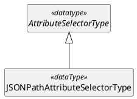
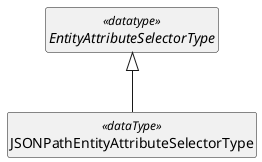

---
# Document metadata processed by Pandoc:
logo: |
  
# Original logo: http://docs.oasis-open.org/templates/OASISLogo-v3.0.png
title: ACAL v1.0 JSONPath Profile Version 1.0
subtitle: Committee Specification Draft 02
version: "1.0"
stage_revision: csd02 # [stage-abbrev][revisionNumber] as defined in https://docs.oasis-open.org/specGuidelines/ndr/namingDirectives.html
lang: en
keywords: ["access", "authorization", "ABAC", "policylanguage", "JSON", "JSONPath", "standard"]
# date metadata is set automatically to current date, unless specified on pandoc commandline: --metadata date="..."
# If metadata 'x' is a string, any placeholder %x% will be replaced with the value of metadata 'x' (using meta_vars.lua filter), e.g. %version% will be replaced with the version metadata value.

# Filters-specific metadata
#   - pandoc-xnos filter configuration ( https://github.com/tomduck/pandoc-secnos#markdown-syntax )
#     In generated section references, the section number is automatically preceded by the reference name "section", e.g. "section X.Y.Z".
xnos-cleveref: True

#   - abstract-section.lua filter configuration
#      This will put the section with ID 'prologue' in an eponymous variable ($prologue$) used in the Pandoc template to put the section content (all its subsections) in the right place before the ToC.
abstract-section:
  section-identifiers:
    - prologue
---

# Prologue {#prologue .unnumbered .unlisted}

### This version {.unnumbered .unlisted}


- https://docs.oasis-open.org/acal/acal/profiles/jsonpath/v%version%/%stage_revision%/acal-jsonpath-v%version%-%stage_revision%.html (Authoritative)
- https://docs.oasis-open.org/acal/acal/profiles/jsonpath/v%version%/%stage_revision%/acal-jsonpath-v%version%-%stage_revision%.pdf
- https://docs.oasis-open.org/acal/acal/profiles/jsonpath/v%version%/%stage_revision%/acal-jsonpath-v%version%-%stage_revision%.md

### Previous version {.unnumbered .unlisted}

- https://docs.oasis-open.org/acal/acal/profiles/jsonpath/v1.0/csd01/acal-jsonpath-v1.0-csd01.html (Authoritative)
- https://docs.oasis-open.org/acal/acal/profiles/jsonpath/v1.0/csd01/acal-jsonpath-v1.0-csd01.pdf
- https://docs.oasis-open.org/acal/acal/profiles/jsonpath/v1.0/csd01/acal-jsonpath-v1.0-csd01.md

### Latest version {.unnumbered .unlisted}

- https://docs.oasis-open.org/acal/acal/profiles/jsonpath/v1.0/acal-jsonpath-v1.0.html (Authoritative)
- https://docs.oasis-open.org/acal/acal/profiles/jsonpath/v1.0/acal-jsonpath-v1.0.pdf
- https://docs.oasis-open.org/acal/acal/profiles/jsonpath/v1.0/acal-jsonpath-v1.0.md


### Technical Committee {.unnumbered .unlisted}

[OASIS Attribute-Centric Authorization Language (ACAL) \[supersedes XACML\]](https://groups.oasis-open.org/communities/tc-community-home2?CommunityKey=67afe552-0921-49b7-9a85-018dc7d3ef1d)


### Chairs {.unnumbered .unlisted}


- Bill Parducci (bill@parducci.net), Individual


### Secretaries {.unnumbered .unlisted}


- Bill Parducci (bill@parducci.net), Individual 


### Editors {.unnumbered .unlisted}


- Steven Legg (steven.legg@viewds.com), ViewDS Identity Solutions
- Cyril Dangerville (cyril.dangerville@thalesgroup.com), THALES
- Bill Parducci (bill@parducci.net), Individual


### Additional artifacts {.unnumbered .unlisted}


This document is one component of a Work Product that also includes:

* [XML schema](acal-jsonpath-xml-v4.0-schema.xsd) (XACML representation);
* [JSON schema](acal-jsonpath-json-v%version%-schema.json) (JACAL representation);
* [YAML structural schema](acal-jsonpath-yaml-v%version%-structure.schema.yaml) (YACAL representation).


### Abstract {.unnumbered .unlisted}


This specification is a profile of ACAL that provides ACAL extensions based on the JSONPath standard, such as the JSONPath attribute selectors `JSONPathAttributeSelectorType` and `JSONPathEntityAttributeSelectorType`. 


### Citation Format {.unnumbered .unlisted}


When referencing this document, the following citation format should be used:

**[ACAL-JSONPath-1.0]**
_%title%_.
Edited by Steven Legg, Cyril Dangerville and Bill Parducci. %date%. OASIS %subtitle%. https://docs.oasis-open.org/acal/acal/profiles/jsonpath/v%version%/%stage_revision%/acal-jsonpath-v%version%-%stage_revision%.html. Latest version: https://docs.oasis-open.org/acal/acal/profiles/jsonpath/v1.0/acal-jsonpath-v1.0.html.


### Related Work {.unnumbered .unlisted}

This document is related to:

- _Attribute-Centric Authorization Language (ACAL) Version 1.0_. Edited by Steven Legg, Cyril Dangerville and Bill Parducci. https://docs.oasis-open.org/acal/acal/core/v1.0/acal-core-v1.0.html


## License, Document Status, and Notices {.unnumbered .unlisted}


Copyright © OASIS Open 2026. All Rights Reserved.  For license and copyright information, and complete status, please see Annex A which contains the License, Document Status and Notices.

---


<!-- ToC auto-generated by Pandoc (including the section numbers, except for Annexes/Appendices which don't follow the same numbering scheme (start with a letter)) with ToC title coming from -- variable toc-title="..." argument -->

---


# Scope


This ACAL profile defines concrete types of [[ACAL-Core-1.0](#acal-core-10)] `AttributeSelectorType` and `EntityAttributeSelectorType` using JSONPath [[RFC9535](#rfc9535)] expressions to extract attributes from ACAL Request's `Content`.

The XML, JSON and YAML representations of ACAL are defined by separate specifications (XACML [[XACML-Core-4.0](#xacml-core-40)], JACAL [[JACAL-Core-1.0](#jacal-core-10)] and YACAL [[YACAL-Core-1.0](#yacal-core-10)]); this profile defines its extensions to those representations and provides the corresponding schemas.


---


# Definitions and Acronyms


## Definitions


### Terms Defined Elsewhere


This document uses the following terms defined elsewhere:

See Section 2 of [[ACAL-Core-1.0](#acal-core-10)].

### Terms Defined in this Document

None.

### Related terms

None.


## Abbreviations and Acronyms

None.

---


# Document Conventions


## Key Words


The key words "**MUST**", "**MUST NOT**", "**REQUIRED**", "**SHALL**", "**SHALL NOT**", "**SHOULD**", "**SHOULD NOT**", "**RECOMMENDED**", "**NOT RECOMMENDED**", "**MAY**", and "**OPTIONAL**" in this document are to be interpreted as described in BCP 14 [[RFC2119](#rfc2119)] [[RFC8174](#rfc8174)] when, and only when, they appear in all capitals, as shown here.


## Typographical Conventions


None.

---


# Introduction (non-normative)


## Requirements

JSON is a common format to represent structured objects that may be supplied by the PEP as subject attribute or resource attribute's Content inside the Request to the PDP, typically a JSON Web token (JWT) in the case of subject attributes (JWT is commonly used in OpenID Connect and OAuth protocols), or any JSON document as resource data. JSON is a common data exchange format used by Web APIs. For such cases, supporting JSONPath [[RFC9535](#rfc9535)] expressions in ACAL is the standard way and therefore a must-have to extract the necessary values from the JSON content for policy evaluation. For instance, a common rule of a privacy policy is that a person should be allowed to read records (in JSON) for which he or she is the subject. The corresponding policy must contain a reference - JSONPath expression - to the subject identified in the information resource - JSON record - itself.

## Policies Based on Subject and Resource Attributes

Attribute selectors (`AttributeSelectorType` objects) defined by this profile use a JSONPath expression [[RFC9535](#rfc9535)] over the `ContentType` object of the subject (resp. resource) to identify a particular subject (resp. resource) attribute value by its location in the context (see Section 5.2 of [[ACAL-Core-1.0](#acal-core-10)] for an explanation of context).


## Changes From the Previous Version


The list of changes from the previous version and any revision history can be found in [Appendix 2](#appendix-2-changes-from-previous-version).

---

# Structures

## ContentType restrictions

This profile applies to a `Content` object (defined in [[ACAL-Core-1.0](#acal-core-10)]) in the Request if and only if:
- The `MediaType` property is set to `application/json`.
- The `Body` property value is a JSON object. *Note that it is always possible to encapsulate a JSON array inside a JSON object if a JSON array is really needed.*

## ACAL extensions

The structures in this profile are extensions to [[ACAL-Core-1.0](#acal-core-10)] model and described here in abstract terms. The representation of these structures in XML, JSON and YAML follows the XACML, JACAL and YACAL specifications; the corresponding schemas are artifacts of this profile.

The types `AttributeSelectorType` and `EntityAttributeSelectorType` used in the next UML models are defined in [[ACAL-Core-1.0](#acal-core-10)].

### AttributeSelectorType extension - JSONPathAttributeSelectorType

A `JSONPathAttributeSelectorType` object is a concrete type of `AttributeSelectorType` from [[ACAL-Core-1.0](#acal-core-10)] that uses JSONPath [[RFC9535](#rfc9535)] for `Path` expressions and expects a JSON object as value of the `Body` property of a `RequestEntityType` object's `Content` object. More precisely, the returned values SHALL be constructed from the node(s) selected by applying the JSONPath expression given by the attribute selector's `Path` property to the JSON object in the `Body` property of the `Content` object in the `RequestEntityType` object matching the attribute selector's `Category` property. 

See @sec:attribute-selector-evaluation for details of attribute selector evaluation.

UML definition (class diagram):


In the context of this profile, the required `Path` property inherited from the supertype `AttributeSelectorType` SHALL be a JSONPath expression [[RFC9535](#rfc9535)].


### EntityAttributeSelectorType extension - JSONPathEntityAttributeSelectorType

A `JSONPathEntityAttributeSelectorType` object is a concrete type of `EntityAttributeSelectorType` [[ACAL-Core-1.0](#acal-core-10)] that uses JSONPath [[RFC9535](#rfc9535)] for `Path` expressions and expects a JSON object in the value returned by the attribute selector's `Expression` property. In other words, the values SHALL be constructed from the node(s) selected by applying the JSONPath expression given by the entity attribute selector's `Path` property to the JSON object of the `Body` property of the `Content` object in either an attribute category in the request context (`RequestEntity`) or the value of the `urn:oasis:names:tc:acal:1.0:data-type:entity` data type returned by its `Expression` evaluation.

See @sec:attribute-selector-evaluation for details of entity attribute selector evaluation.

UML definition (class diagram):


The `Path` property is also defined the same as in `JSONPathAttributeSelectorType`.

---


# Attribute Selector Evaluation


A `JSONPathAttributeSelectorType` or `JSONPathEntityAttributeSelectorType` object SHALL be evaluated according to the following processing model.

: Note: It is not necessary for an implementation to exactly follow this model. It is only necessary to produce results identical to those that would be produced by following this model.

The first steps are already described in [[ACAL-Core-1.0](#acal-core-10)] section 8.4.7 and provided here as a reminder:


- If the attribute category given by the `Category` property is not found or does not have a `Content` property, then the return value is either `Indeterminate` or an empty bag as determined by the `MustBePresent` property.

- If the `Expression` property of a `JSONPathEntityAttributeSelectorType` object evaluates to a value of the `urn:oasis:names:tc:acal:1.0:data-type:entity` data type and that value does not have a `Content` property, then the return value is either `Indeterminate` or an empty bag as determined by the `MustBePresent` property.

- If the `Expression` property of a `JSONPathEntityAttributeSelectorType` object evaluates to a value of the `urn:oasis:names:tc:acal:1.0:data-type:anyURI` data type and an attribute category with that value as its `Category` is not found or does not have a `Content` property, then the return value is either `Indeterminate` or an empty bag as determined by the `MustBePresent` property.

If the designated attribute category or entity value has a `Content` property, then follow the steps below:

1. Construct a JSON object ([[RFC8259](#rfc8259)]) from the value of the `Body` property of the `Content` property. If the content is not a valid JSON object, then the attribute selector MUST return `Indeterminate` with status code `urn:oasis:names:tc:acal:1.0:status:syntax-error`.

2. The root node of the data structure (JSON object) SHALL be used as context node of evaluation (JSONPath *query argument*).

3. Evaluate the JSONPath expression given in the `Path` property against the context node selected in the previous step, according to the syntax and semantics of the JSONPath standard [[RFC9535](#rfc9535)].

4. The result of the previous step is a nodelist that is converted to a bag of values of the data type specified by the `DataType` property. In most cases the conversion depends on the string value of a node's JSON value, defined as follows:

    * The string value of a JSON string value is the sequence of Unicode characters represented by the text _between_ the surrounding double quotes, i.e., with each escape sequence replaced with its equivalent Unicode character.

    * The string value of the special JSON value `true`, `false` or `null` is the equivalent sequence of Unicode characters.

    * The string value of a JSON number is the equivalent sequence of Unicode characters.

    * The string value of a JSON array is the empty string.

    * The string value of a JSON object is the empty string.

&nbsp;
: The nodelist is converted to a bag of values of the data type specified by the `DataType` property as follows:

&nbsp;
: If the specified data type is `urn:oasis:names:tc:acal:1.0:data-type:boolean`, then convert the string value of each node using the `xs:boolean()` constructor function from [[XF](#xf)] Section 18.1.

&nbsp;
: If the specified data type is `urn:oasis:names:tc:acal:1.0:data-type:string`, then convert the string value of each node using the `xs:string()` constructor function from [[XF](#xf)] Section 18.1.

&nbsp;
: If the specified data type is `urn:oasis:names:tc:acal:1.0:data-type:integer`, then convert the string value of each node using the `xs:integer()` constructor function from [[XF](#xf)] Section 18.1.

&nbsp;
: If the specified data type is `urn:oasis:names:tc:acal:1.0:data-type:double`, then convert the string value of each node using the `xs:double()` constructor function from [[XF](#xf)] Section 18.1.

&nbsp;
: If the specified data type is `urn:oasis:names:tc:acal:1.0:data-type:dateTime`, then convert the string value of each node using the `xs:dateTime()` constructor function from [[XF](#xf)] Section 18.1.

&nbsp;
: If the specified data type is `urn:oasis:names:tc:acal:1.0:data-type:date`, then convert the string value of each node using the `xs:date()` constructor function from [[XF](#xf)] Section 18.1.

&nbsp;
: If the specified data type is `urn:oasis:names:tc:acal:1.0:data-type:time`, then convert the string value of each node using the `xs:time()` constructor function from [[XF](#xf)] Section 18.1.

&nbsp;
: If the specified data type is `urn:oasis:names:tc:acal:1.0:data-type:hexBinary`, then convert the string value of each node using the `xs:hexBinary()` constructor function from [[XF](#xf)] Section 18.1.

&nbsp;
: If the specified data type is `urn:oasis:names:tc:acal:1.0:data-type:base64Binary`, then convert the string value of each node using the `xs:base64Binary()` constructor function from [[XF](#xf)] Section 18.1.

&nbsp;
: If the specified data type is `urn:oasis:names:tc:acal:1.0:data-type:anyURI`, then convert the string value of each node using the `xs:anyURI()` constructor function from [[XF](#xf)] Section 18.1.

&nbsp;
: If the specified data type is `urn:oasis:names:tc:acal:1.0:data-type:yearMonthDuration`, then convert the string value of each node using the `xs:yearMonthDuration()` constructor function from [[XF](#xf)] Section 18.1.

&nbsp;
: If the specified data type is `urn:oasis:names:tc:acal:1.0:data-type:dayTimeDuration`, then convert the string value of each node using the `xs:dayTimeDuration()` constructor function from [[XF](#xf)] Section 18.1.

&nbsp;
: If the specified data type is one of `urn:oasis:names:tc:acal:1.0:data-type:x500Name`, `urn:oasis:names:tc:acal:1.0:data-type:rfc822Name`, `urn:oasis:names:tc:acal:1.0:data-type:ipAddress` or `urn:oasis:names:tc:acal:1.0:data-type:dnsName`, then convert the string value of each node using `urn:oasis:names:tc:acal:1.0:function:x500Name-from-string`, `urn:oasis:names:tc:acal:1.0:function:rfc822Name-from-string`, `urn:oasis:names:tc:acal:1.0:function:ipAddress-from-string` or `urn:oasis:names:tc:acal:1.0:function:dnsName-from-string` respectively ([[ACAL-Core-1.0](#acal-core-10)] Annex C.3.9), using the same rule those functions use elsewhere in a policy for which strings are valid lexical representations of the target data type. If the applicable function evaluates to `Indeterminate`, that is an error in converting the node (see below), not the `syntax-error` result the function itself would give elsewhere in a policy.

&nbsp;
: If the specified data type is `urn:oasis:names:tc:acal:1.0:data-type:entity` and the value of every node in the nodelist is a JSON object, then convert each node to an ACAL `EntityType` object. Each `EntityType` object SHALL have a `Content` property and SHALL NOT have an `Attribute` property. The `Content` property SHALL have a `MediaType` property set to `application/json` and the value of the `Body` property SHALL be a copy of the JSON object.

&nbsp;
: If the data type is one of the types referred to above and the result of step 3 does not satisfy any of the cases, then the attribute selector MUST return `Indeterminate` with status code `urn:oasis:names:tc:acal:1.0:status:syntax-error`.

&nbsp;
: If the data type is not one of the types referred to above, then the return values SHALL be constructed from the nodelist in a manner specified by the particular data type extension specification. If the data type extension does not specify an appropriate conversion function, then the attribute selector MUST return `Indeterminate` with status code `urn:oasis:names:tc:acal:1.0:status:syntax-error`.

&nbsp;
: If an error occurs when converting the values returned by the expression to the specified data type — including a `urn:oasis:names:tc:acal:1.0:function:x500Name-from-string`, `urn:oasis:names:tc:acal:1.0:function:rfc822Name-from-string`, `urn:oasis:names:tc:acal:1.0:function:ipAddress-from-string` or `urn:oasis:names:tc:acal:1.0:function:dnsName-from-string` function evaluating to `Indeterminate` for a node's string value — then the result of the attribute selector MUST be `Indeterminate`, with status code `urn:oasis:names:tc:acal:1.0:status:processing-error`.

&nbsp;
: If the result of step 3 is an empty nodelist, then the return value is either `Indeterminate` with status code `urn:oasis:names:tc:acal:1.0:status:syntax-error`, or an empty bag, as determined by the `MustBePresent` property.

An implementation can be optimized to emit errors without going to the effort of generating the string value of node values. For example, the string value of a JSON number will never have the correct format for a `urn:oasis:names:tc:acal:1.0:data-type:dateTime` ACAL value, so this combination will always produce an error.

---


# Safety, Security, and Data Protection Considerations


Refer to [[ACAL-Core-1.0](#acal-core-10)] section 10, and Section 4 (Security Considerations) of [[RFC9535](#rfc9535)].

---


# Conformance

## Conformance Tables

This section lists those portions of the specification that MUST be included in an implementation of a PDP that claims to conform to this profile.

: Note: "M" means mandatory-to-implement. "O" means optional.

The implementation MUST follow the @sec:structures, @sec:attribute-selector-evaluation and [Annex C](#annex-c-acal-identifiers) where they apply to implemented items in the following tables.

### Object Types

The implementation MUST support the object types that are marked `M`.

| Object Type | M/O |
| :--- | :--- |
| JSONPathAttributeSelectorType | M |
| JSONPathEntityAttributeSelectorType | O |

---


# Annex A License, Document Status and Notices {.unnumbered}


(This annex forms an integral part of this Specification.)


## A.1 Document Status {.unnumbered}


This document was last revised or approved by the OASIS ACAL \[XACML\] TC on the above date. The level of approval is also listed above. Check the "Latest version" location noted above for possible later revisions of this document. Any other numbered Versions and other technical work produced by the Technical Committee (TC) are listed at https://groups.oasis-open.org/communities/tc-community-home2?CommunityKey=67afe552-0921-49b7-9a85-018dc7d3ef1d#technical.


TC members should send comments on this document to the TC's email list. Others should send comments to the TC's public comment list, after subscribing to it by following the instructions at the "Send A Comment" button on the TC's web page at https://www.oasis-open.org/committees/acal/.


NOTE: any machine-readable content (Computer Language Definitions) declared Normative for this Work Product is provided in separate plain text files. In the event of a discrepancy between any such plain text file and display content in the Work Product's prose narrative document(s), the content in the separate plain text file prevails.


## A.2 License and Notices {.unnumbered}


Copyright © OASIS Open 2026. All Rights Reserved.


All capitalized terms in the following text have the meanings assigned to them in the OASIS Intellectual Property Rights Policy (the "OASIS IPR Policy"). The full Policy, which governs the licensure of this document, may be found at the OASIS website: [[https://www.oasis-open.org/policies-guidelines/ipr/](https://www.oasis-open.org/policies-guidelines/ipr/)]


This document and translations of it may be copied and furnished to others, and derivative works that comment on or otherwise explain it or assist in its implementation may be prepared, copied, published, and distributed, in whole or in part, without restriction of any kind, provided that the above copyright notice and this section are included on all such copies and derivative works. However, this document itself may not be modified in any way, including by removing the copyright notice or references to OASIS, except as needed for the purpose of developing any document or deliverable produced by an OASIS Technical Committee (in which case the rules applicable to copyrights, as set forth in the OASIS IPR Policy, must be followed) or as required to translate it into languages other than English.


The limited permissions granted above are perpetual and will not be revoked by OASIS or its successors or assigns, as provided in the OASIS IPR Policy.


This document is provided under the [RF on Limited Terms](https://www.oasis-open.org/policies-guidelines/ipr/#RF-on-Limited-Mode) IPR mode that was chosen when the project was established, as defined in the IPR Policy. For information on whether any patents have been disclosed that may be essential to implementing this document, and any offers of patent licensing terms, please refer to the Intellectual Property Rights section of the project’s web page ([OASIS ACAL \[XACML\] TC IPR page](https://www.oasis-open.org/committees/acal/ipr.php)).


This document and the information contained herein is provided on an "AS IS" basis and OASIS DISCLAIMS ALL WARRANTIES, EXPRESS OR IMPLIED, INCLUDING BUT NOT LIMITED TO ANY WARRANTY THAT THE USE OF THE INFORMATION HEREIN WILL NOT INFRINGE ANY OWNERSHIP RIGHTS OR ANY IMPLIED WARRANTIES OF MERCHANTABILITY OR FITNESS FOR A PARTICULAR PURPOSE. OASIS AND ITS MEMBERS WILL NOT BE LIABLE FOR ANY DIRECT, INDIRECT, SPECIAL OR CONSEQUENTIAL DAMAGES ARISING OUT OF ANY USE OF THIS DOCUMENT OR ANY PART THEREOF.


As stated in the OASIS IPR Policy, the following three paragraphs in brackets apply to OASIS Standards Final Deliverable documents (Committee Specifications, OASIS Standards, or Approved Errata).


OASIS requests that any OASIS Party or any other party that believes it has patent claims that would necessarily be infringed by implementations of this OASIS Standards Final Deliverable, to notify OASIS TC Administrator and provide an indication of its willingness to grant patent licenses to such patent claims in a manner consistent with the IPR Mode of the OASIS Technical Committee that produced this deliverable.


OASIS invites any party to contact the OASIS TC Administrator if it is aware of a claim of ownership of any patent claims that would necessarily be infringed by implementations of this OASIS Standards Final Deliverable by a patent holder that is not willing to provide a license to such patent claims in a manner consistent with the IPR Mode of the OASIS Technical Committee that produced this OASIS Standards Final Deliverable. OASIS may include such claims on its website, but disclaims any obligation to do so.


OASIS takes no position regarding the validity or scope of any intellectual property or other rights that might be claimed to pertain to the implementation or use of the technology described in this OASIS Standards Final Deliverable or the extent to which any license under such rights might or might not be available; neither does it represent that it has made any effort to identify any such rights. Information on OASIS' procedures with respect to rights in any document or deliverable produced by an OASIS Technical Committee can be found on the OASIS website. Copies of claims of rights made available for publication and any assurances of licenses to be made available, or the result of an attempt made to obtain a general license or permission for the use of such proprietary rights by implementers or users of this OASIS Standards Final Deliverable, can be obtained from the OASIS TC Administrator. OASIS makes no representation that any information or list of intellectual property rights will at any time be complete, or that any claims in such list are, in fact, Essential Claims.


The name "OASIS" is a trademark of OASIS, the owner and developer of this document, and should be used only to refer to the organization and its official outputs. OASIS welcomes reference to, and implementation and use of, its documents, while reserving the right to enforce its marks against misleading uses. Please see [OASIS Trademark Policy](https://www.oasis-open.org/policies-guidelines/trademark/) for guidance.


---


# Annex B References {.unnumbered}


(This annex forms an integral part of this Specification.)


This section contains the normative references that are used in this document; it has no informative references. 


Normative references are specific (identified by date of publication and/or edition number or version number) and Informative references are either specific or non-specific. For specific references, only the cited version applies. For non-specific references, the latest version of the reference document (including any amendments) applies. While any hyperlinks included in this section were valid at the time of publication, OASIS cannot guarantee their long term validity.


## B.1 Normative References {.unnumbered}


The following documents are referenced in such a way that some or all of their content constitutes requirements of this document.

###### [ACAL-Core-1.0] {#acal-core-10}

_Attribute-Centric Authorization Language (ACAL) Version 1.0_. Edited by Steven Legg, Cyril Dangerville and Bill Parducci. https://docs.oasis-open.org/acal/acal/core/v1.0/acal-core-v1.0.html

###### [JACAL-Core-1.0] {#jacal-core-10}

_JACAL Version 1.0 (JSON Representation of ACAL)_. Edited by Steven Legg, Cyril Dangerville and Bill Parducci. https://docs.oasis-open.org/acal/jacal/core/v1.0/acal-core-json-v1.0.html

###### [RFC2119]

*Key Words for Use in RFCs to Indicate Requirement Levels*, BCP 14, RFC 2119, March 1997. [Online]. Available: https://www.rfc-editor.org/info/rfc2119

###### [RFC8174]

*Ambiguity of Uppercase vs Lowercase in RFC 2119 Key Words*, BCP 14, RFC 8174, May 2017. [Online]. Available: https://www.rfc-editor.org/info/rfc8174

###### [RFC8259] {#rfc8259}

Bray, T., Ed., "The JavaScript Object Notation (JSON) Data Interchange Format", STD 90, RFC 8259, DOI 10.17487/RFC8259, December 2017, <https://www.rfc-editor.org/info/rfc8259>.

###### [RFC9535]

RFC 9535, *JSONPath: Query Expressions for JSON*, February 2024. [Online]. Available: https://datatracker.ietf.org/doc/html/rfc9535

###### [XF]

XPath and XQuery Functions and Operators 3.1, 21 March 2017, https://www.w3.org/TR/2017/REC-xpath-functions-31-20170321/

###### [XACML-Core-4.0] {#xacml-core-40}

_XACML Version 4.0 (eXtensible Access Control Markup Language)_. Edited by Steven Legg, Cyril Dangerville and Bill Parducci. https://docs.oasis-open.org/acal/xacml/core/v4.0/acal-core-xml-v4.0.html

###### [YACAL-Core-1.0] {#yacal-core-10}

_YACAL Version 1.0 (YAML Representation of ACAL)_. Edited by Steven Legg, Cyril Dangerville and Bill Parducci. https://docs.oasis-open.org/acal/yacal/core/v1.0/acal-core-yaml-v1.0.html

# Annex C ACAL Identifiers {.unnumbered}


(This annex forms an integral part of this Specification.)

This section defines standard identifiers for commonly used definitions.

## C.1 ACAL Namespaces {.unnumbered}

This ACAL Profile is defined using this identifier.

`urn:oasis:names:tc:acal:1.0:jsonpath:schema`

---

# Annex D How to generate HTML and PDF versions {.unnumbered}

(This annex does not form an integral part of this Specification and is informational.)

## D.1 Online generation {.unnumbered}

HTML/PDF versions are generated automatically online via Github Actions after each update pushed to the main branch of [OASIS ACAL \[XACML\] TC Github repository](https://github.com/oasis-tcs/acal-spec/). Go to  Github Actions on the github repository, then go to the latest workflow run, and, if the run succeeded, the summary should display the links to the generated HTML/PDF documents.

## D.2 Offline generation {.unnumbered}

### Prerequisites {.unnumbered}

The following software must be installed on the system:
- Pandoc **v3.2.1 or later** ( [latest release](https://github.com/jgm/pandoc/releases/latest) )
- Pandoc filters: [pandoc-include](https://github.com/DCsunset/pandoc-include), [pandoc-xnos filter (Timothy Elder's fork! not the original one) ](https://github.com/TimothyElder/pandoc-xnos), [pandoc-secnos](https://github.com/tomduck/pandoc-secnos). The two latter MUST be installed in that order (make sure any old pandoc-xnos install that is not coming from Elder's fork has been removed and replaced with the fork);
- [PlantUML](https://plantuml.com/starting) and [Graphviz](https://graphviz.org/), for the UML diagrams.

Git clone or get a local copy of [OASIS ACAL \[XACML\] TC Github repository](https://github.com/oasis-tcs/acal-spec/), open a terminal and **change your working directory to the root directory of your local copy of the repository**.

### CSS stylesheet {.unnumbered}

The generation command uses the CSS stylesheet file `pandoc/styles/markdown-styles-v1.7.3b.css` (with `-c` argument) based on the [v1.7.3a](https://docs.oasis-open.org/templates/css/markdown-styles-v1.7.3a.css) provided by OASIS.

### HTML generation {.unnumbered}

Run the following command line to generate the HTML from this markdown file (input file specified as last argument):

```console
$ pandoc/mkdocs.sh --number-lines --output /tmp acal-jsonpath-v%version%.md --number-sections=true --filter pandoc-secnos --lua-filter=pandoc/abstract-section.lua --toc=true --variable toc-title="Table of Contents" --toc-depth=5
```
The `--output` option sets the output directory, and the output filename is the same as the input file (last argument) except `.md` extension is replaced with `.html`.

The publication date is automatically set to the current date by default (using Lua filter `pandoc/meta_vars.lua`). However, you may set a specific date of your choice instead, by adding the argument `--metadata date="My date in the form DD Month YYYY"` at the end of the command. 

### PDF generation {.unnumbered}

For PDF output, add the `--pdf` option as follows:

```console
$ pandoc/mkdocs.sh --number-lines --pdf --output /tmp acal-jsonpath-v%version%.md --number-sections=true --filter pandoc-secnos --lua-filter=pandoc/abstract-section.lua --toc=true --variable toc-title="Table of Contents" --toc-depth=5
```

The HTML file is generated like the previous command and, in addition, a PDF file is generated with the same name as the input file except the `.md` extension is replaced with `.pdf` in this case.

Beware that **the result PDF - the embedded fonts in particular - may differ depending on the system/machine** where you run this command. Mainly, it depends on which fonts are actually installed on the system, as the HTML-to-PDF converter (Chrome / Chromium in this case) selects available fonts according to the prioritized lists defined by `font-family` properties in the CSS.

**For official TC publications**, add the `--official` argument to avoid this issue and produce a system-independent output:

```console
$ pandoc/mkdocs.sh --number-lines --pdf --official --output /tmp acal-jsonpath-v%version%.md --number-sections=true --filter pandoc-secnos --lua-filter=pandoc/abstract-section.lua --toc=true --variable toc-title="Table of Contents" --toc-depth=5
```

In this case, the generation will use a public Linux container image (`ghcr.io/oasis-tcs/chrome-headless`) with a fixed installed set of fonts to generate the PDF.

# Appendix 1 Acknowledgments {.unnumbered}


(This appendix does not form an integral part of this Specification and is informational.)


## Leadership {.unnumbered}


The following individuals have had significant leadership positions during the development of this document, not just this version of the document, and they are gratefully acknowledged:


- Chairs
  - Bill Parducci, Individual
- Secretaries
  - Bill Parducci, Individual
- Editors
  - Steven Legg, ViewDS Identity Solutions
  - Cyril Dangerville, THALES
  - Bill Parducci, Individual


## Participants {.unnumbered}


The following individuals were members of this committee during the creation of this document, not just this version of the document, and their contributions are gratefully acknowledged:

**OASIS ACAL \[XACML\] TC Members:**

- Bill Parducci, Individual
- Steven Legg, ViewDS Identity Solutions
- Cyril Dangerville, THALES


---


# Appendix 2 Changes From Previous Version {.unnumbered}


(This appendix does not form an integral part of this Specification and is informational.)


This is the first version of this profile; its previous stage was Committee Specification Draft 01. The changes made since then are the following.

- The attribute selector evaluation (@sec:attribute-selector-evaluation) now converts a node's string value to a value of data type `urn:oasis:names:tc:acal:1.0:data-type:x500Name`, `rfc822Name`, `ipAddress` or `dnsName` using the corresponding `-from-string` function of [[ACAL-Core-1.0](#acal-core-10)] Annex C.3.9; when that function evaluates to `Indeterminate`, the attribute selector returns `Indeterminate` with status code `urn:oasis:names:tc:acal:1.0:status:processing-error`.
- The Scope no longer says that concrete representations are out of scope of this document: this profile now defines its extensions to the XML, JSON and YAML representations and provides the corresponding schemas.
- The XML, JSON and YAML schemas for this profile's extensions are listed as artifacts of this profile (Additional artifacts); at csd01 only the XML schema was listed, with the XACML representation specification.
- The conformance section no longer says that special functions are not required to be implemented, and no longer carries the deprecated-identifier paragraph (this profile defines no deprecated identifiers); the Introduction subsection of the conformance section, which held the first of these, is removed.
- Requirements previously written with lowercase "shall" in the selector type descriptions (@sec:structures) and in the attribute selector evaluation (@sec:attribute-selector-evaluation) are written with the uppercase keyword SHALL.
- Sections are numbered automatically, and the cross-references to sections of this profile and of [[ACAL-Core-1.0](#acal-core-10)] are corrected.
- [Annex D](#annex-d-how-to-generate-html-and-pdf-versions) describes online generation by the repository's GitHub Actions workflow and offline generation with `pandoc/mkdocs.sh`, lists the tools that script requires, and no longer describes a Docker alternative.
- Editorial: the Technical Committee is renamed, and document and repository URLs are updated accordingly; and the references are corrected.

## Revision History {.unnumbered}

Latest revision history can be obtained from [OASIS ACAL \[XACML\] TC's github repository](https://github.com/oasis-tcs/acal-spec/blob/v%version%-%stage_revision%/acal-jsonpath-v%version%-%stage_revision%.md).


<!-- The following centered line represents the end of the document -->  
\_\_\_\_\_\_\_\_\_\_\_\_\_\_\_\_\_\_\_\_\_\_\_\_\_\_\_\_\_\_\_\_\_\_\_\_\_\_\_\_
